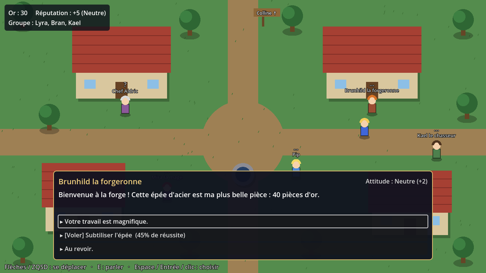
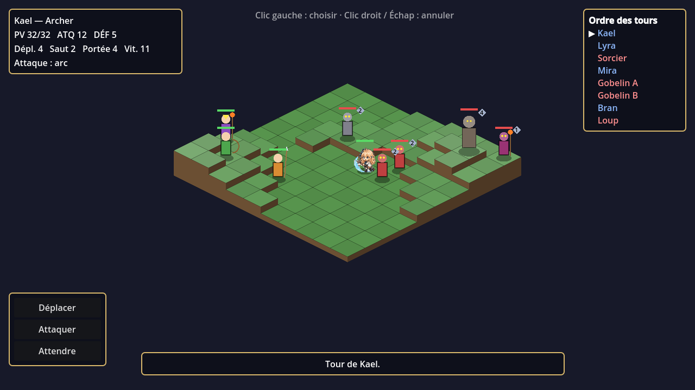

# Tactics 2D — prototype Godot

Prototype de RPG 2D inspiré de **Final Fantasy Tactics Advance** (combat tactique
sur grille isométrique) et d'**Octopath Traveler** (faiblesses/Break, actions de
chemin comme le vol). Lyra a ses sprites pixel et ses portraits ; le reste est
encore dessiné en code.

| Village | Combat |
|---|---|
|  |  |

## Lancer

1. Installer [Godot 4.5](https://godotengine.org/download) (version standard, pas .NET).
2. Ouvrir Godot → **Importer** → choisir `project.godot`.
3. **F5** pour jouer (la scène principale est le village).

## Contrôles

- **Village** : flèches ou ZQSD pour bouger, **E** pour parler, Espace/Entrée/clic pour choisir une réponse.
- **Combat** : clic gauche pour choisir (Déplacer / Attaquer / Attendre puis la case), clic droit ou Échap pour annuler.

## Dialogues et perception des PNJ

Chaque PNJ a une **opinion** personnelle de Lyra, et le village partage une
**réputation**. Ce que le PNJ pense vraiment (sa *perception*) =
`opinion + réputation / 2`, affichée en couleur au-dessus de sa tête
(Hostile, Méfiant, Neutre, Amical, Dévoué).

- Les réponses changent l'opinion du PNJ (compliment, générosité, insulte…).
- Les **témoins** : certaines actions (voler, rudoyer un enfant, être généreuse)
  sont vues par les PNJ à moins de 300 px, qui changent d'avis eux aussi.
- Les actions risquées (ex. **voler** l'épée) ont un pourcentage de réussite ;
  un échec se paie cher (opinion, réputation, témoins).
- Les dialogues s'adaptent : textes différents selon l'opinion, la réputation et
  ce que tu as fait (le chef sait si tu as été payée d'avance, Pip répète les
  rumeurs, la forgeronne remarque l'épée disparue…).

### Conséquences

| PNJ | Ce qui peut arriver |
|---|---|
| Chef Aldric | Donne la quête. Négocier = or tout de suite mais récompense réduite. Refuser = réputation en baisse. |
| Brunhild (forge) | Vend l'épée (ATQ +4), la donne si elle t'apprécie, ou tu peux la voler. |
| Kael (chasseur) | Rejoint le groupe si son opinion ≥ 30. Donne des infos sur les faiblesses. |
| Mira (mage) | Rejoint le groupe seulement si ta **réputation** ≥ 15. |
| Pip (enfant) | Bon moyen de gagner (ou perdre) de la réputation devant témoins. |

Sans alliés, Lyra et Bran perdent presque toujours contre les 5 ennemis :
**tes choix au village décident du combat**. La victoire ou la défaite modifie à
son tour la réputation et les dialogues.

## Combat

- **Charge Time** (style FFT) : chaque unité agit quand son CT atteint 100 ;
  la vitesse fait monter le CT. Attendre sans agir fait revenir plus vite.
- **Hauteur** : le saut limite les déplacements ; frapper d'en haut = +10 % par niveau.
- **Faiblesses / Break** (style Octopath) : chaque ennemi a un bouclier et des
  faiblesses (épée, lance, arc, feu). Toucher une faiblesse retire un point ;
  à 0 l'ennemi est **brisé** : il perd son prochain tour et subit des dégâts doublés.

## Art de Lyra

Les images viennent de la planche de référence `assets/reference/lyra_sheet.webp`,
découpée par `tools/extract_lyra.py` (`pip install pillow`, puis
`python3 tools/extract_lyra.py`) :

- `assets/lyra/sprites/` : sprites pixel (~32×46, fond transparent, 32 couleurs) :
  `idle`, `marche`, `course`, `saut`, `attaque`, `cast`, `hit`, `mort`.
  Utilisés au village (marche) et en combat (attaque, coup reçu, K.O.).
- `assets/lyra/portraits/` : portraits de dialogue (140×140) :
  `souriante`, `clin_oeil`, `colere`, `surprise`, `triste`, `rougissante`.
  L'expression suit la scène : clé `"lyra"` d'un nœud de dialogue, sinon elle
  est déduite des effets (opinion en hausse = sourire, en baisse = tristesse).

Pour améliorer l'art, il suffit d'écraser les PNG en gardant les mêmes noms :
le code ne change pas. Les sprites doivent regarder vers la gauche
(sinon passer `FACES_LEFT` à `false` dans `scripts/lyra_art.gd`). Godot est
réglé en filtre « Nearest » pour garder le pixel net.

Limites actuelles : une seule image par animation (la marche alterne idle et
marche) et une seule direction (retournée en miroir).

## Ajouter du contenu

- **Dialogues** : `scripts/dialogues.gd` (format documenté en tête de fichier :
  conditions `opinion_min`, `rep_min`, `flag`…, effets `opinion`, `reputation`,
  `witnessed`, `set`, `gold`, `battle`).
- **PNJ du village** : liste `npcs` dans `scripts/village.gd`.
- **Unités et carte de combat** : `PLAYER_UNITS`, `ENEMY_UNITS` et `MAP_ROWS`
  dans `scripts/battle.gd`.
- **État de la partie** (or, réputation, opinions, drapeaux) : `scripts/game_state.gd`.

## Test rapide sans jouer

```sh
godot --headless --path . res://scenes/battle.tscn -- --autoplay              # groupe de base
godot --headless --path . res://scenes/battle.tscn -- --autoplay --full-party # avec Kael, Mira, épée
```
L'IA joue les deux camps et affiche `RÉSULTAT : victoire/défaite`.

## Brumeval (le monde vivant)

Deux dossiers à part, qui ne touchent pas au prototype Tactics :

- [`brumeval/`](brumeval/LISEZMOI.md) : un second projet Godot (4.3+), le village de Brumeval en 3D façon HD-2D, en temps réel, avec ses 19 habitants. Ouvrir `brumeval/project.godot` dans Godot.
- [`monde/`](monde/univers.md) : la conception du monde (univers, peuples, classes, compétences, combat, création de personnage, la République et ses 410 PNJ, la chronique jour par jour, les cartes, les données CSV).
