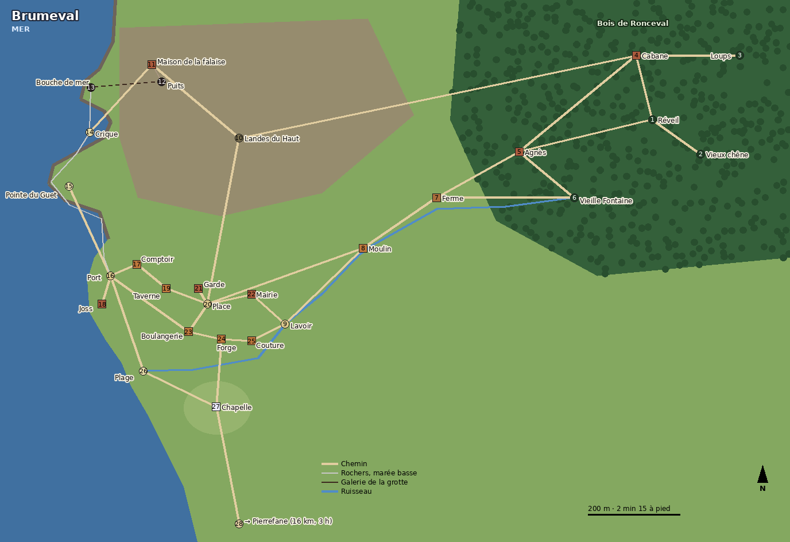

# Plan de Brumeval

> Le village de départ, en plan. C'est la référence pour les distances, les trajets, les horaires et les terrains de combat. Le [jour 1 avec le joueur](../chronique/joueur/jour_001_avec_joueur.md) et la [grotte](../donjons/grotte_de_brumeval.md) suivent ce plan. Les données pour Godot sont dans [donnees/lieux](../donnees/lieux/).

## L'échelle

- **1 case = 1 mètre.** C'est la même case que la grille de combat : quand un combat éclate, la grille se pose sur le décor, case pour case.
- **On marche à 1,5 m par seconde** et on court à 4 m par seconde. À cheval, c'est 6 m par seconde, mais il n'y a pas de cheval à Brumeval (seuls Garec et Mouche en ont un, à partir du jour 10).
- **Le temps est réel** : traverser le village prend vraiment une minute, aller chez Agnès en prend dix. Il n'y a pas de téléportation.
- **Le relief compte.** Les falaises du nord font 25 m de haut, la butte de la chapelle 14 m, le port et la plage sont au ras de l'eau. Monter coûte du temps, et la hauteur donne l'avantage en combat.
- **Le village tient dans un rectangle de 1,7 km sur 1,2 km.** Le cœur (place, taverne, boulangerie, forge, mairie) tient en 200 m : tout s'y entend, tout s'y voit.

## Les lieux

Les numéros sont ceux du plan.

| # | Lieu | Qui y vit ou y travaille | Ouvert | Ce qui s'y cache |
| --- | --- | --- | --- | --- |
| 1 | **Clairière du réveil** | — | toujours | L'endroit où le joueur se réveille ; un cercle de pierres moussues que personne ne remarque |
| 2 | **Vieux chêne** | — | toujours | La Lame sans nom dans les racines (1 chance sur 5 chaque jour) |
| 3 | **Tanière des loups** | Meute de loups | toujours | Os, une besace de voyageur |
| 4 | **Cabane du chasseur** | Pierrick | nuit, 12 h – 14 h | La sculpture de Léa ; peaux, arcs, collets |
| 5 | **Maison de la guérisseuse** | Agnès ; Nina à partir du jour 6 | toujours ouverte de 6 h à 19 h | Les remèdes et les secrets de la moitié du village ; un tiroir de poisons |
| 6 | **La Vieille Fontaine** | — | toujours | La source du ruisseau ; une vieille pierre gravée des sept astres |
| 7 | **Ferme Champart** | Basile, ses chiens | 5 h – 20 h | La rigole qu'il rouvre en douce les jours pairs |
| 8 | **Moulin Dumoulin** | Élise | 6 h – 17 h, et certaines nuits | Le grain moulu de nuit pour Silas |
| 9 | **Lavoir** | — | toujours | Les commérages du matin |
| 10 | **Landes du Haut** | Moutons de Basile | toujours | Le chemin que prend Pierrick pour sa ronde |
| 11 | **Maison de la falaise** | Nina (dort dans la cave jusqu'au jour 5) | — | Le puits du jardin (entrée de la grotte) ; cartes marines moisies |
| 12 | **Puits du jardin Marbre** | — | — | Entrée de la grotte de Brumeval |
| 13 | **Bouche de mer** | — | marée basse seulement | Sortie de la grotte ; la barque noire de Vesperine dès la nuit du jour 1 |
| 14 | **Crique** | — | contrebande de 23 h à 2 h | Débarquements de Silas ; un feu de camp caché |
| 15 | **Falaise d'en face (pointe du Guet)** | — | toujours | La copie du registre cachée par Théo (jour 9) ; vue sur toute la crique |
| 16 | **Port** | — | 5 h – 19 h | Les rumeurs du matin ; la cale du Goéland gris |
| 17 | **Comptoir de Silas** | Silas (chambre à l'étage) | 9 h – 12 h, 19 h | Le registre des dettes (volé au jour 7) ; la cellule sous le plancher, par une trappe |
| 18 | **Cabane de Joss** | Joss | nuit, 13 h – 15 h | Une lettre jamais envoyée à Maëlle |
| 19 | **Taverne du Hareng Rieur** | Rosalie ; à l'étage : Théo (jusqu'au jour 11), Garec et Mouche (dès le jour 10), le joueur s'il paie | 10 h – minuit | Rosalie entend tout ; les murs sont à Clémence |
| 20 | **Place du village** | — | marché de 8 h à 13 h | Le puits, la halle, le vieux pilori |
| 21 | **Corps de garde** | Corentin | 8 h – 18 h | Le bout de papier où Corentin note ce qu'il voit à la crique |
| 22 | **Mairie, maison Montval** | Aldric, Clémence, Gaëlle (jusqu'au jour 10) | 8 h – 12 h, 14 h – 18 h | Les « commissions » de Clémence ; le coffre aux créances |
| 23 | **Boulangerie et maison Fournier** | Mara, Tim (à l'étage) | boutique 8 h – 14 h ; fournil dès 5 h | La pièce d'or de Tim (brûlée au jour 2) |
| 24 | **Forge et maison Ferrand** | Bram, Lucas (maison derrière la forge) | 6 h – 17 h ; seulement le matin à partir du jour 11 | Les économies de Lucas ; le registre caché (jour 8) |
| 25 | **Atelier de couture** | Isaure (chambre à l'étage) | 8 h – 18 h | Les tissus pris à crédit chez Silas |
| 26 | **Plage** | — | toujours | L'embouchure du ruisseau ; galets pour les ricochets de Tim |
| 27 | **Chapelle des Sept Astres** | Ysolde (sacristie) | 6 h – 21 h ; toit la nuit | Le carnet d'Ysolde sur Silas ; le vitrail brisé |
| 28 | **Sentier côtier (vers Pierrefane)** | — | toujours | Pierrefane à 16 km, 3 h de marche |
## Les trajets

Les temps sont comptés par les chemins, pas à vol d'oiseau.

| Trajet | Distance | À pied | En courant | Raccourci |
| --- | --- | --- | --- | --- |
| Place du village → Taverne du Hareng Rieur | 106 m | 1 min 15 | 30 s | |
| Place du village → Corps de garde | 43 m | 30 s | 15 s | |
| Place du village → Mairie, maison Montval | 108 m | 1 min 15 | 30 s | |
| Place du village → Boulangerie et maison Fournier | 81 m | 1 min | 15 s | |
| Boulangerie et maison Fournier → Forge et maison Ferrand | 81 m | 1 min | 15 s | |
| Forge et maison Ferrand → Atelier de couture | 73 m | 45 s | 15 s | |
| Place du village → Port | 267 m | 3 min | 1 min | |
| Comptoir de Silas → Taverne du Hareng Rieur | 91 m | 1 min | 30 s | |
| Port → Plage | 264 m | 3 min | 1 min | |
| Place du village → Chapelle des Sept Astres | 339 m | 3 min 45 | 1 min 30 | |
| Place du village → Lavoir | 215 m | 2 min 30 | 1 min | |
| Place du village → Moulin Dumoulin | 413 m | 4 min 30 | 1 min 45 | |
| Moulin Dumoulin → Ferme Champart | 223 m | 2 min 30 | 1 min | |
| Place du village → Maison de la guérisseuse | 873 m | 9 min 45 | 3 min 45 | |
| Clairière du réveil → Maison de la guérisseuse | 358 m | 4 min | 1 min 30 | |
| Clairière du réveil → Place du village | 1231 m | 13 min 45 | 5 min 15 | |
| Cabane du chasseur → Clairière du réveil | 180 m | 2 min | 45 s | |
| Place du village → Maison de la falaise | 709 m | 8 min | 3 min | |
| Maison de la falaise → Crique | 280 m | 3 min | 1 min 15 | |
| Place du village → Crique | 990 m | 11 min | 4 min | À marée basse, par les rochers : 677 m, 7 min 30 |
| Taverne du Hareng Rieur → Crique | 1096 m | 12 min 15 | 4 min 30 | À marée basse, par les rochers : 571 m, 6 min 15 |
| Moulin Dumoulin → Crique | 1403 m | 15 min 30 | 5 min 45 | À marée basse, par les rochers : 1090 m, 12 min |
| Crique → Bouche de mer | — | — | — | À marée basse, par les rochers : 127 m, 1 min 30 |
| Port → Falaise d'en face (pointe du Guet) | 268 m | 3 min | 1 min | |
| Chapelle des Sept Astres → Sentier côtier (vers Pierrefane) | 312 m | 3 min 30 | 1 min 15 | |
Pour **Pierrefane**, le sentier côtier fait 16 km : 3 h à pied, 2 h en courant par moments, et tu arrives épuisé (*Fatigué*).

**Courir se voit.** Quelqu'un qui court au village fait parler. Courir la nuit sur le sentier de la crique, c'est un jet d'Agilité 8 ou la chute (2 à 8 dégâts, et tout le monde t'entend).

## Les marées

La mer monte et descend deux fois par jour, sur un vrai cycle de 12 h 25. Les passages « marée basse » (les rochers entre le port et la crique, la Bouche de mer) sont ouverts **de 2 h avant à 2 h après la basse mer**. Le reste du temps, il faut nager (Endurance 10) ou prendre une barque.

| Jour | Basse mer | Pleine mer |
| --- | --- | --- |
| 1 | 9 h 15 et 21 h 40 | 3 h 00 et 15 h 30 |
| 2 | 10 h 05 et 22 h 30 | 3 h 50 et 16 h 20 |
| 3 | 10 h 55 et 23 h 20 | 4 h 40 et 17 h 10 |
| Ensuite | +50 min chaque jour | +50 min chaque jour |

C'est pour ça que Vesperine arrive à 21 h 30 le jour 1 : la Bouche de mer n'est ouverte qu'à cette heure-là. Et c'est pour ça que Silas décharge à la crique, où l'on accoste à toute heure.

## Le terrain de chaque lieu

Les règles des terrains sont dans [combat.md](../combat.md), section 7.

| # | Lieu | Hauteur | Terrain en combat |
| --- | --- | --- | --- |
| 1 | Clairière du réveil | 32 m | Herbe haute, souches (couvert), brume le matin (obscurité légère avant 8 h) |
| 2 | Vieux chêne | 34 m | Racines (déplacement −1), tronc (couvert) |
| 3 | Tanière des loups | 40 m | Rochers (hauteur +1 à +2), ronces (déplacement −1) |
| 4 | Cabane du chasseur | 36 m | Clairière étroite, tas de bois (couvert), arbres (hauteur pour un archer) |
| 5 | Maison de la guérisseuse | 22 m | Jardin d'herbes sèches (brûle), chats partout |
| 6 | La Vieille Fontaine | 24 m | Eau peu profonde, mousse |
| 7 | Ferme Champart | 15 m | Paille et foin (brûle), clôtures (couvert), boue près de la bergerie |
| 8 | Moulin Dumoulin | 8 m | Roue et bief (eau profonde), sacs de farine (couvert), grenier (hauteur +2) |
| 9 | Lavoir | 4 m | Eau peu profonde, pierre glissante |
| 10 | Landes du Haut | 30 m | Bruyère sèche (brûle), vent, aucun couvert |
| 11 | Maison de la falaise | 28 m | Pièces en ruine, plancher pourri (chute à l'étage du dessous) |
| 12 | Puits du jardin Marbre | 28 m | Jardin en friche, ronces |
| 13 | Bouche de mer | 0 m | Sable mouillé, eau peu profonde, rochers |
| 14 | Crique | 0 m | Galets, rochers (couvert), eau peu profonde puis profonde, obscurité la nuit |
| 15 | Falaise d'en face (pointe du Guet) | 22 m | Hauteur +3 sur la crique, vent, bord de falaise (chute) |
| 16 | Port | 1 m | Quai de pierre, caisses (couvert), eau profonde au bord |
| 17 | Comptoir de Silas | 2 m | Entrepôt, tonneaux (couvert, explosent au feu s'ils sont d'eau-de-vie) |
| 18 | Cabane de Joss | 1 m | Filets (entravent), barque retournée (couvert) |
| 19 | Taverne du Hareng Rieur | 3 m | Tables et bancs (couvert), escalier (hauteur), cave |
| 20 | Place du village | 4 m | Pavés, étals (couvert), puits |
| 21 | Corps de garde | 4 m | Pièce étroite, râtelier d'armes |
| 22 | Mairie, maison Montval | 6 m | Perron (hauteur +1), salon meublé (couvert) |
| 23 | Boulangerie et maison Fournier | 4 m | Four (feu), sacs de farine (couvert ; la farine en l'air explose au feu) |
| 24 | Forge et maison Ferrand | 5 m | Enclume, braises (feu), outils (armes improvisées) |
| 25 | Atelier de couture | 5 m | Rouleaux de tissu (brûlent), mannequins (couvert) |
| 26 | Plage | 0 m | Sable (déplacement −1), eau peu profonde puis profonde |
| 27 | Chapelle des Sept Astres | 14 m | Lieu sacré (lumière ×1,2), butte (hauteur +2), échafaudage (hauteur +4) |
| 28 | Sentier côtier (vers Pierrefane) | 10 m | Lande, vent, falaises basses |
## L'intérieur des maisons

Entrer dans une maison ne fait pas sortir du temps : la journée continue dehors pendant que tu es dedans.

| Bâtiment | Pièces | À savoir |
| --- | --- | --- |
| **Taverne du Hareng Rieur** | Salle basse avec la scène de Félix, comptoir, cuisine, cave à tonneaux ; à l'étage, quatre chambres et celle de Rosalie | La chambre du joueur coûte 1 pièce d'argent repas compris. Les cloisons sont fines : d'une chambre, on entend la voisine. La cave a une trappe vers la cour. |
| **Comptoir de Silas** | Entrepôt avec la balance, bureau, arrière-salle fermée ; chambre de Silas à l'étage | Une trappe dans le plancher de l'arrière-salle mène à **la cellule** : 2 m sur 3, un anneau au mur, pas de fenêtre. Vesperine y passe la nuit du jour 1. |
| **Mairie, maison Montval** | Perron, salle du conseil, salon, salle à manger, couloir, cuisine ; chambres à l'étage, dont celle de Gaëlle | Le coffre aux créances de Clémence est dans sa chambre. La fenêtre de Gaëlle donne sur la cour, et la cour sur la ruelle. |
| **Boulangerie** | Boutique, fournil avec le four ; logement de Mara et Tim à l'étage | La fenêtre du fournil donne sur la ruelle du port : c'est par là que Tim file. |
| **Forge** | Forge ouverte sur la rue, réserve ; la maison Ferrand derrière, deux pièces | Les économies de Lucas sont sous une latte. Le registre volé y est caché au jour 8. |
| **Atelier de couture** | Boutique, atelier, cabine d'essayage ; chambre d'Isaure à l'étage | De sa fenêtre, Isaure voit la forge. |
| **Chapelle des Sept Astres** | Nef, autel, vitrail brisé, sacristie (où vit Ysolde), salle d'école, clocher, toit, jardin d'herbes | On monte au toit par le clocher : c'est là qu'Ysolde observe les étoiles à 21 h. L'échafaudage du vitrail tient mal. |
| **Moulin** | Salle des meules, roue et bief, grenier à grain, chambre d'Élise | Du grenier, on voit la place et la route du moulin. La lumière du moulin la nuit se voit depuis la falaise d'en face. |
| **Ferme Champart** | Maison, bergerie, grange à foin, chenil | Les chiens aboient à 50 m. |
| **Maison de la guérisseuse** | Cuisine, herbier, chambre d'Agnès, grenier (où dort Nina dès le jour 6) | Une trentaine de pots sans étiquette ; Agnès sait ce qu'il y a dans chacun. |
| **Cabane du chasseur** | Une pièce, un établi de sculpteur, un appentis à peaux | La sculpture de Léa est sous une toile. |
| **Maison de la falaise** | Rez-de-chaussée en ruine, étage au plancher pourri, cave ; jardin en friche avec le puits | On entre par la fenêtre de la cave, que Nina connaît. La porte d'entrée est clouée. |
| **Corps de garde** | Une pièce, un râtelier, une couchette | Corentin y dort en fin de journée (18 h) avant sa veille de nuit. |
| **Cabane de Joss** | Une pièce, des filets, une barque retournée devant | Une lettre jamais envoyée à sa fille Maëlle. |

## Ce qui change sur la carte au fil des jours

| Jour | Changement |
| --- | --- |
| 1, nuit | La barque noire de Vesperine est cachée à la Bouche de mer. |
| 6 | Nina quitte la cave de la maison de la falaise pour le grenier d'Agnès. |
| 7 | La balance du comptoir est brisée ; le registre des dettes disparaît. |
| 9 | Théo cache la copie du registre dans une fente de la falaise d'en face. |
| 10 | Gaëlle part avec Félix sur le *Goéland gris*. Garec et Mouche s'installent à la taverne avec leurs chevaux. |
| 11 | Théo part pour Vaulx-sur-Mer. La forge ne travaille plus que le matin. |

Tout ce que le joueur casse, brûle ou construit reste sur la carte : une maison incendiée reste en ruine, un pont réparé reste réparé.

## Pour Godot

- **Une seule grande scène pour le village**, découpée en morceaux de 64 × 64 cases chargés autour du joueur. Pas d'écran de chargement entre la place et le port.
- **Les intérieurs sont des petites scènes à part.** On les charge en passant la porte, mais l'horloge du monde continue.
- **Les PNJ hors de vue continuent leur journée** en version simplifiée : ils sautent d'un lieu à l'autre selon leur emploi du temps et le temps de trajet de ce plan. Quand le joueur s'approche, ils redeviennent visibles là où ils devraient être.
- **Les données :**
  - `donnees/lieux/brumeval_lieux.csv` : un lieu par ligne, avec son numéro, ses coordonnées en mètres, sa hauteur, ses habitants, ses horaires, son accès, ce qu'il cache et son terrain de combat.
  - `donnees/lieux/brumeval_chemins.csv` : les chemins entre lieux, avec leur distance, le temps à pied et en courant, et leurs conditions (marée basse, nuit…).
- Le plan est en vue de dessus. En HD-2D, le décor sera en 3D avec les sprites des personnages posés dessus. Ce plan sert de patron : la place du moindre bâtiment, les hauteurs et les chemins.
