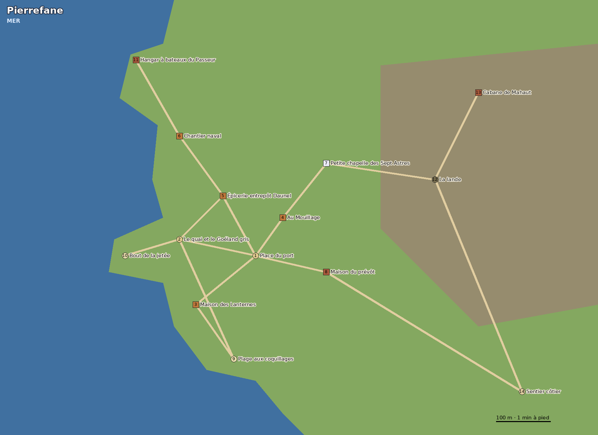

# Plan de Pierrefane

> La ville portuaire à 16 km au sud de Brumeval, par le sentier côtier (3 h de marche). Le décor est celui de [Pierrefane](../republique/pierrefane.md) ; ce plan est la référence pour le jeu. Les données pour Godot : `brumeval/data/pierrefane/` (tirées de `brumeval/outils/pierrefane_data.py` par `build_carte.py`).

## L'échelle

- **1 case = 1 mètre**, comme à Brumeval. La carte fait 1,1 km sur 800 m ; la mer est à l'ouest.
- **La ville tient autour de l'anse** : du hangar du Passeur au nord à la plage aux coquillages au sud, 600 m. Les rues sont bordées de maisons serrées, crépi blanc et ardoise.
- **À l'est, la lande** monte vers la cabane de Mahaut (44 m), et le sentier côtier part vers Brumeval.

## Les lieux

| # | Lieu | Qui y vit ou y travaille | Ouvert | Ce qui s'y cache |
| --- | --- | --- | --- | --- |
| 1 | Place du port | — | toujours | Le marché aux poissons du matin |
| 2 | Le quai et le Goéland gris | Capitaine Daunel, Yann, Kael | toujours | Le Goéland gris part tous les 6 jours vers Saltevaux |
| 3 | Maison des Lanternes | Madame Orsoline, Hugues, Margo, Lysa, Bastien | 18 h – 4 h | Le carnet d'Orsoline ; la cave des captifs punis |
| 4 | Au Mouillage (auberge) | Ondine, Pâris, Fleur | 6 h – 23 h | Les ragots d'Ondine ; l'arrière-salle des dés |
| 5 | Épicerie-entrepôt Daunel | Bérénice, Ambroise, Yann | 7 h – 19 h | Le dossier secret de Bérénice |
| 6 | Chantier naval | Maître Ferrat, Thorga | 6 h – 18 h | La forge d'ancres de Thorga ; une coque à moitié finie |
| 7 | Petite chapelle des Sept Astres | Sœur Odile | toujours ouverte | Les messages des Libres sous l'autel |
| 8 | Maison du prévôt | Prévôt Gourdin | 9 h – 12 h, en principe | L'enveloppe d'Orsoline, chaque mois |
| 9 | Plage aux coquillages | — | toujours | Les coquillages de Fleur |
| 10 | Bout de la jetée | — | toujours | Là où Kael mange seul, à midi |
| 11 | Hangar à bateaux du Passeur | Gilles le Passeur | jour : il dort ; nuit : en mer | Les barques des fugitifs vers Aëlinde |
| 12 | La lande | — | toujours | Le chemin de nuit de Kael |
| 13 | Cabane de Mahaut | Vieille Mahaut | à toute heure si on vient la chercher | Les noms des enfants vendus |
| 14 | Sentier côtier (vers Brumeval) | — | toujours | Brumeval à 16 km, 3 h de marche |

## Les chemins

| De | À | Distance | À pied |
| --- | --- | --- | --- |
| Place du port | Le quai et le Goéland gris | 157 m | 1.7 min |
| Place du port | Au Mouillage (auberge) | 95 m | 1.1 min |
| Place du port | Maison des Lanternes | 163 m | 1.8 min |
| Place du port | Maison du prévôt | 147 m | 1.6 min |
| Place du port | Épicerie-entrepôt Daunel | 144 m | 1.6 min |
| Épicerie-entrepôt Daunel | Chantier naval | 156 m | 1.7 min |
| Épicerie-entrepôt Daunel | Le quai et le Goéland gris | 130 m | 1.4 min |
| Chantier naval | Hangar à bateaux du Passeur | 210 m | 2.3 min |
| Le quai et le Goéland gris | Bout de la jetée | 110 m | 1.2 min |
| Maison des Lanternes | Plage aux coquillages | 140 m | 1.6 min |
| Plage aux coquillages | Le quai et le Goéland gris | 290 m | 3.2 min |
| Au Mouillage (auberge) | Petite chapelle des Sept Astres | 147 m | 1.6 min |
| Petite chapelle des Sept Astres | La lande | 243 m | 2.7 min |
| La lande | Cabane de Mahaut | 215 m | 2.4 min |
| La lande | Sentier côtier (vers Brumeval) | 527 m | 5.9 min |
| Maison du prévôt | Sentier côtier (vers Brumeval) | 527 m | 5.9 min |

## Dans le jeu

- **Y aller** : au bout du sentier côtier (Brumeval, lieu 28), l'action « Prendre le sentier côtier (3 h) ». Ton équipe marche avec toi ; on revient de la même façon.
- **Les habitants** : les 18 de [donnees/pnj/pierrefane.csv](../donnees/pnj/pierrefane.csv) (sans Vesperine, qui n'y arrive que capturée), avec leurs emplois du temps.
- **Lysa et Bastien** sont captifs (dette, contrat) : rien d'intime avec eux, jamais. Yann (17 ans) et Fleur (9 ans) sont des enfants.
- **Margo** est une courtisane libre : l'action « Monter avec Margo (2 argent) », au salon des Lanternes, de 18 h à 4 h. Elle refuse qui elle n'aime pas, et qui l'a forcée à dire le mot d'arrêt.
- **Le Mouillage** : dormir (1 argent), la soupe de poisson, danser, et le travail de nuit libre (au port aussi) : personne ne prend sa part.
- **Les défis** : le bras de fer de Thorga, la course de Kael sur la lande.
- **Après une défaite**, on se réveille chez la vieille Mahaut.
